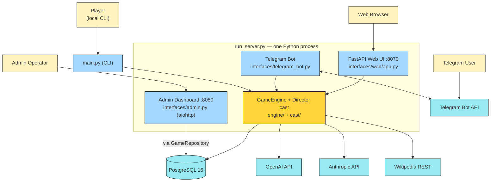
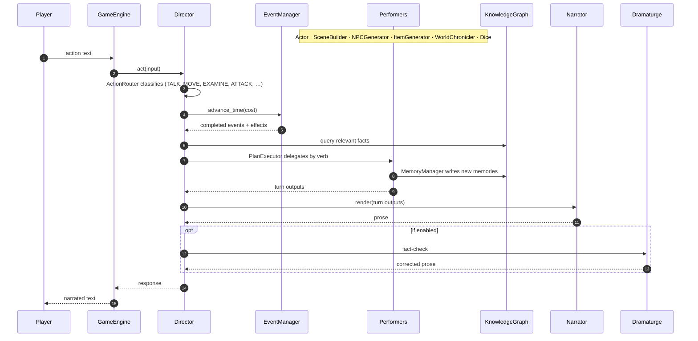
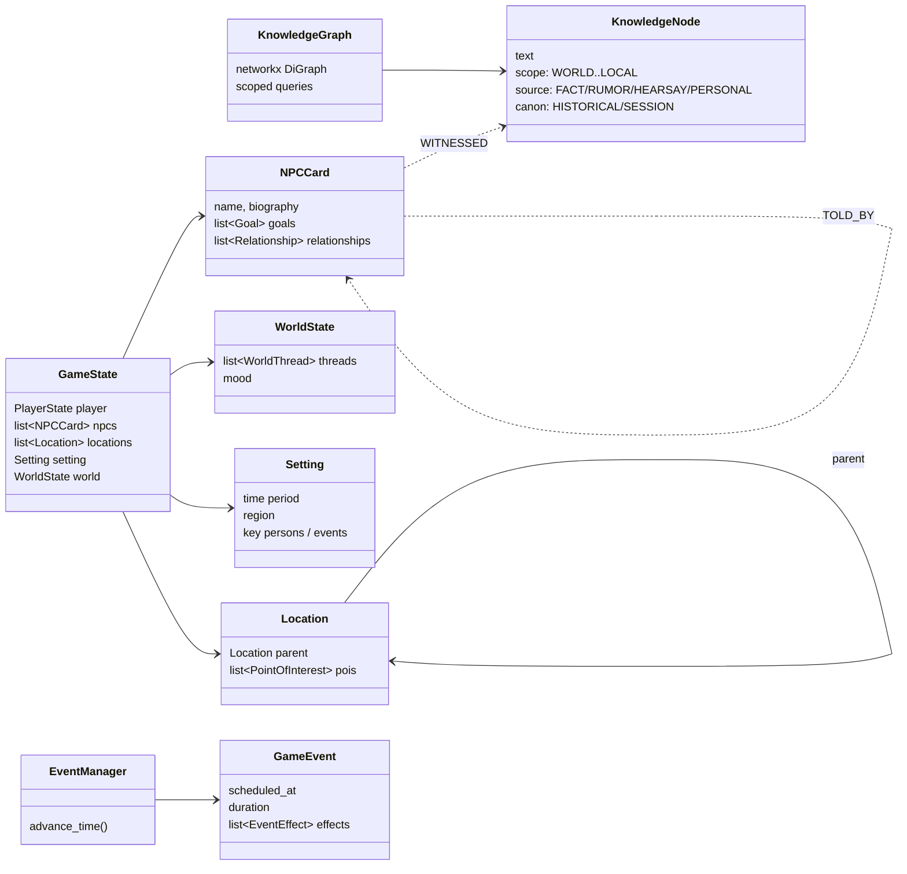
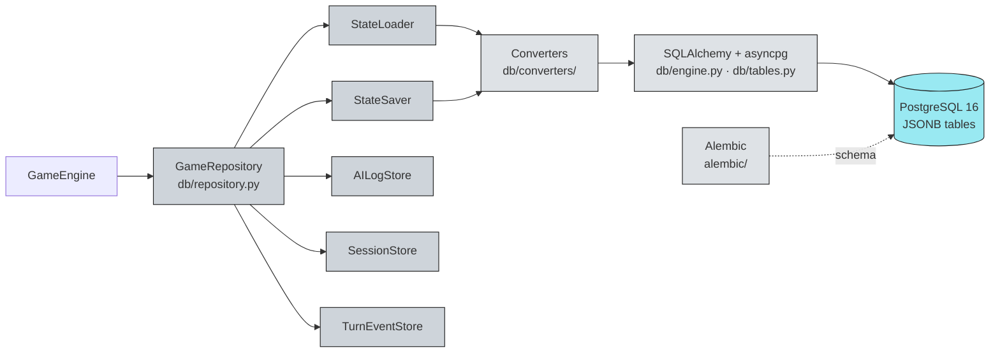

# Storyteller — Architecture

Four small diagrams, each answering one question.  Renders inline on GitHub.

---

## 1. Containers — what runs where

---

## 2. Turn flow — what happens when the player types something

The Director is the only orchestrator.  Performers (`cast/`) are stateless workers; all persistent world state lives in `GameState` + `KnowledgeGraph` + `EventManager`.

---

## 3. State model — what the world looks like in memory

Knowledge edges (`WITNESSED`, `TOLD_BY`) are how rumors propagate and how each NPC knows different things.

---

## 4. Persistence path — how a turn reaches Postgres

`GameState` and `KnowledgeGraph` are serialized into JSONB columns via the converters in `db/converters/`; relational columns are reserved for FKs and indexes.

---

## Where to look in the code

| Concern | Path |
| --- | --- |
| Public engine API | `engine/game_engine.py`, `engine/factory.py` |
| Orchestrator | `cast/director.py` |
| Performers | `cast/{actor,narrator,scene_builder,npc_generator,data_miner,item_generator,world_chronicler,dramaturge,dice}.py` |
| Performer base | `cast/base_performer_class.py` |
| Domain models | `models/` |
| Knowledge graph | `knowledge/graph.py`, `knowledge/node.py`, `knowledge/query.py`, `knowledge/memory.py` |
| Game clock | `timeline/event_manager.py`, `timeline/time_costs.py` |
| LLM layer | `llm/factory.py`, `llm/{openai,anthropic}_client.py` |
| Prompts | `prompts/base_template.py`, `prompts/*_prompts.py` |
| Persistence | `db/repository.py`, `db/converters/`, `db/tables.py` |
| Web UI | `interfaces/web/app.py`, `interfaces/web/service.py`, `engine/session_ops.py` |
| Telegram | `interfaces/telegram_bot.py` |
| Admin | `interfaces/admin.py` |
| Wikipedia | `research/wikipedia_client.py` |
