# Game Loop

This document describes Storyteller's turn flow — what happens from the moment
a player submits an action to the moment a narrated response is returned and
the game state is persisted.

For an overview of the theater-style multi-agent architecture, see the
**Architecture** section of [`CLAUDE.md`](../CLAUDE.md).

## Turn Flow

```mermaid
flowchart TD
    Player([Player submits action]) --> Engine["GameEngine.process_action()<br/><i>engine/game_engine.py</i>"]
    Engine --> Director["Director.act()<br/><i>cast/director.py</i>"]

    Director --> Router["ActionRouter.route_action()<br/><i>cast/director_routing.py</i>"]
    Router -->|classify| Routing{{"action_type<br/>targets<br/>is_aggressive"}}

    Routing -->|needs_clarification| Clarify[/Return clarifying question/]
    Clarify --> Done([Response to player])

    Routing -->|incapacitated| ForceWait[[Force WAIT]]
    ForceWait --> Advance

    Routing -->|ok| Advance["EventManager.advance_time()<br/><i>timeline/event_manager.py</i>"]
    Advance --> Clock[/"Advance game clock<br/>Resolve completed events<br/>Apply effects<br/>Schedule follow-ups"/]

    Clock --> Dispatch{Action type?}

    Dispatch -->|WAIT| Ambience["Refresh scene ambience<br/>(threads · on-shift NPCs ·<br/>imminent events)"]

    Dispatch -->|EXPLORE / MOVE| SceneBuilder["SceneBuilder.execute()<br/><i>cast/scene_builder.py</i>"]
    SceneBuilder --> SceneUpdate[/"Update current_scene<br/>Increment scene_number"/]
    SceneUpdate --> NPCInit["DialogueHandler.init_scene_npcs()"]

    Dispatch -->|TALK / INTERACT / EXAMINE / OTHER| NPCInit

    NPCInit --> NPCGen{"Target NPC<br/>known?"}
    NPCGen -->|no| Generator["NPCGenerator.execute()<br/><i>cast/npc_generator.py</i>"]
    Generator --> Handler
    NPCGen -->|yes| Handler

    Handler{Handler by type}
    Handler -->|TALK| Actor["Actor.execute()<br/><i>cast/actor.py</i>"]
    Handler -->|EXAMINE| ItemGen["ItemGenerator.execute()"]
    Handler -->|INTERACT| ObjectInt["ObjectInteraction handler"]

    Actor --> NPCTurns
    ItemGen --> NPCTurns
    ObjectInt --> NPCTurns
    Ambience --> NPCTurns

    NPCTurns["NPCTurnResolver.resolve_npc_turns()<br/><i>cast/npc_turn.py</i><br/>(autonomous NPC actions,<br/>retaliation)"]
    NPCTurns --> Ticker["NPCTicker.tick()<br/>(schedules · mood decay)"]

    Ticker --> SceneChanged{Scene<br/>changed?}
    SceneChanged -->|yes| Rumors["EventProcessor.propagate_rumors_for_turn()"]
    Rumors --> Chronicler["WorldChronicler.execute()<br/><i>cast/world_chronicler.py</i>"]
    Chronicler --> Memory
    SceneChanged -->|no| Memory

    Memory["MemoryManager.summarize_interactions_batch()<br/><i>knowledge/memory.py</i><br/>(knowledge graph edges)"]

    Memory --> Narrator["Narrator.execute()<br/><i>cast/narrator.py</i>"]
    Narrator --> Dramaturge{"New scene<br/>AND dramaturge?"}
    Dramaturge -->|yes| Review["Dramaturge.execute()<br/>(consistency check)"]
    Dramaturge -->|no| Persist
    Review --> Persist

    Persist["GameRepository.save_game_state()<br/><i>db/repository.py</i>"]
    Persist --> Done

    classDef agent fill:#e1f0ff,stroke:#2b6cb0,color:#1a365d;
    classDef state fill:#fff4e1,stroke:#b7791f,color:#744210;
    classDef decision fill:#f0e1ff,stroke:#6b46c1,color:#44337a;
    classDef io fill:#e1ffe6,stroke:#2f855a,color:#22543d;

    class Director,Router,SceneBuilder,Generator,Actor,ItemGen,ObjectInt,NPCTurns,Ticker,Chronicler,Memory,Narrator,Review agent;
    class Advance,Clock,SceneUpdate,Ambience,Rumors,Persist state;
    class Dispatch,Handler,NPCGen,SceneChanged,Dramaturge,Routing decision;
    class Player,Engine,Done,Clarify,ForceWait,NPCInit io;
```

## Initial Setup (one-shot, before the first turn)

```mermaid
flowchart LR
    Start([start_game setting_description]) --> DataMiner["DataMiner.execute()<br/><i>cast/data_miner.py</i>"]
    DataMiner --> Wiki[("Wikipedia research")]
    Wiki --> Facts[/"Structured setting facts"/]
    Facts --> Graph["KnowledgeGraph()<br/><i>knowledge/graph.py</i>"]
    Graph --> Populate["populate_graph_from_setting()<br/>(locations, factions,<br/>historical figures)"]
    Populate --> GameState["GameState()"]
    GameState --> Events["EventManager()"]
    Events --> Wire["wire_director()<br/>(SceneBuilder · Narrator ·<br/>NPCGenerator · ItemGenerator ·<br/>WorldChronicler · MemoryManager)"]
    Wire --> Opening["Director.execute(&quot;Look around&quot;)"]
    Opening --> Ready([Opening narration])
```

## Step Summary

| # | Step | Key file(s) |
|---|------|-------------|
| 1 | **Route** — classify action (EXPLORE, MOVE, TALK, EXAMINE, INTERACT, WAIT, OTHER) | `cast/director_routing.py` |
| 2 | **Advance clock** — apply event effects, schedule follow-ups | `timeline/event_manager.py`, `cast/director_events.py` |
| 3 | **Dispatch** — SceneBuilder for scene-changing actions, Actor/ItemGenerator/ObjectInteraction for others | `cast/director_execution.py` |
| 4 | **NPC turns** — autonomous NPC actions & schedule tick | `cast/npc_turn.py`, `cast/npc_ticker.py` |
| 5 | **World updates** — rumour propagation, WorldChronicler thread progression | `cast/world_chronicler.py` |
| 6 | **Memory** — summarize interactions into the knowledge graph | `knowledge/memory.py` |
| 7 | **Narrate** — Narrator assembles prose; optional Dramaturge review | `cast/narrator.py`, `cast/dramaturge.py` |
| 8 | **Persist** — save GameState, KnowledgeGraph, and events | `db/repository.py` |
